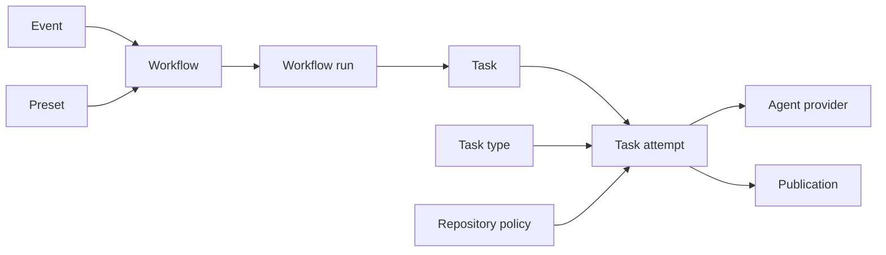

# Glossary

Vocabulary for the Octorun package.
The map describes ownership across the runtime and public API.

Octorun adopts the requested workflow and task vocabulary.
The [source glossary](https://github.com/harlan-zw/harlan-agent-kit/blob/2d184d86bf2aebd9c22ca7d17e30898a7e7f759e/packages/harlan-github-agent/GLOSSARY.md) governs the existing service.
Its restriction of workflow to GitHub Actions does not govern Octorun workflows.

## Map

| Term | Owner | Relationship | Customer word |
| --- | --- | --- | --- |
| Octorun | Package | Runs workflows for configured repositories | Octorun |
| Event | Ingestion | May select several workflows | event |
| Workflow | Repository configuration | Defines an ordered chain of tasks | workflow |
| Workflow run | Runtime | Pins one event, workflow version, and repository snapshot | run |
| Task | Workflow | One configured operation within a workflow | task |
| Task attempt | Scheduler | One execution of a task within a workflow run | attempt |
| Task type | Host registration | Supplies the implementation and capabilities of a task | task type |
| Preset | Package | Supplies a complete reusable workflow definition | preset |
| Agent provider | Provider adapter | Answers agent turns requested by task implementations | agent provider |
| Repository policy | Operator | Limits the capabilities available to workflows | repository policy |
| Publication | GitHub adapter | Records a desired GitHub change and its confirmed result | internal only |
| Review finding | Review preset | Evidence-backed concern attached to reviewed code | finding |

## Terms

### Workflow

A versioned definition that selects events and orders tasks for one repository.
Use workflow for the definition. Use workflow run for one execution.
Qualify GitHub Actions workflow whenever both systems appear together.
Avoid pipeline and Routine as replacement nouns.

### Workflow run

One durable execution against a pinned repository snapshot and workflow version.
A deliberate re-run creates another workflow run.
Recovery continues the original workflow run.
Use run when context already identifies an Octorun workflow.
Avoid session as a replacement noun.

### Task and task attempt

A task defines an operation, inputs, conditions, and limits.
A task attempt records one execution and its result.
Waiting for capacity does not create another attempt.
Use GitHub Actions job and step for GitHub's corresponding concepts.

### Task type and preset

A task type supplies executable behavior registered by the operator.
A preset supplies workflow configuration using registered task types.
A preset cannot grant itself permissions.
Avoid Skill as a replacement noun. Agent Skills remain separate instruction files.

### Event

A durable record of a GitHub delivery, observed state change, or explicit manual request.
An observation records current state. It cannot recreate a missing historical event.
Avoid webhook when referring to events from polling or manual requests.

### Publication

A durable request to change GitHub, with identity and reconciliation evidence.
Use the actual GitHub noun in user interactions: comment, review, check run, or commit.

### Repository policy

Operator limits for one installed repository.
Repository configuration may reduce these limits. It cannot expand them.
Avoid approval as a synonym. A human approval authorizes one specific action.

### Agent provider

The adapter that runs an agent turn and returns typed results and usage.
A workflow run may use different providers across tasks.
Avoid model as a replacement noun. A provider can offer several models.

## Banned

| Avoid in Octorun prose | Use instead | Reason |
| --- | --- | --- |
| Routine for an event-driven definition | workflow | Routine names the existing scheduled service feature |
| worker for an agent provider | agent provider | Scheduling and model execution have different owners |
| session for a workflow run | workflow run | Provider sessions can span several turns |
| issue for a review finding | finding | An issue remains a GitHub issue |

## Public contracts

The package README and guides describe the public API and CLI.
Historical design notes record the wider roadmap.
