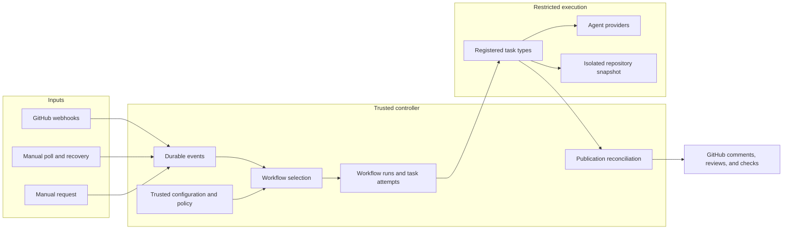

# Workflow architecture

Build Octorun around durable workflow runs.
Use adversarial review as the first preset.
Keep review-specific state outside the generic scheduler.

These are design recommendations. [Source evidence](source-audit.md) describes the inspected implementation.

## Scope

Start with one process, one host, [SQLite](https://sqlite.org), and GitHub App authentication.
Target Linux for the first executable review environment.
Support webhooks, a manual poll, and an explicit manual run through one ingress path.

Ship ordered task chains with conditions over typed prior outputs.
Bound parallel reviewers inside the review task.
Defer arbitrary graphs, dynamic planning, remote task marketplaces, and distributed execution.
Prove generality with a custom chain that contains no review task.

## Boundaries

Keep these boundaries within one package first.
Split internal modules before creating separately versioned packages.

## Runtime choice

Reuse SQLite transactions, lease fencing, and publication reconciliation behind the new contracts.
Keep the scheduler limited to ordered tasks and durable waiting conditions.
This recommendation preserves the single-host installation target.

[Temporal](https://docs.temporal.io/temporal-service/temporal-server) offers an established runtime with separately scalable services.
[DBOS](https://docs.dbos.dev/typescript/tutorials/workflow-tutorial) offers checkpointed TypeScript workflows and explicit workflow IDs.
Both deserve evaluation if distributed execution or recovery maintenance becomes a primary requirement.
Their integration would still need [GitHub](https://github.com) publication fencing and restricted agent execution.
Revisit the choice before adding arbitrary graphs or multiple execution hosts.

| Boundary | Owns | Must not own |
| --- | --- | --- |
| Ingestion | Authentication, parsing, delivery identity, event persistence | Agent starts or GitHub writes |
| Workflow definition | Selectors, ordered tasks, input references, conditions | Host credentials or arbitrary imports |
| Planner | Pure decisions over event, policy, and prior state | SQL or network access |
| Store | Transactions, constraints, leases, migrations | Review routing decisions |
| Scheduler | Admission, attempts, timeouts, cancellation, recovery | Review-specific transitions |
| Task types | Domain behavior and precise outputs | Direct controller-store access |
| Provider adapters | Agent turns, usage, cancellation, structured failures | Publication authority |
| GitHub adapter | Reads and fenced publication reconciliation | Prompt interpretation |

Pass dependencies explicitly. Keep the decision core pure.
Parse configuration and external results once, at their boundary.
Represent expected failures with tagged results. Let unexpected failures surface.

## Workflow contract

Pin each run to its event, repository ID, installation ID, configuration digest, and typed target snapshot.
Use target variants for pull requests, repository revisions, and other supported GitHub objects.
Pull request targets include head and base SHAs. Other targets carry their own identity and revision.
Pin task type versions, provider settings, and applicable repository policy.
Store the compiled workflow definition with the run.
A host upgrade must not silently change an existing run's meaning.

Each task declares its ID, registered type, typed inputs, conditions, capabilities, timeout, and retry limits.
Input references may target only earlier tasks.
Reject duplicate task IDs, unknown types, invalid output references, and incompatible input schemas before admission.
Support bounded JSON values and artifact references between tasks.
Keep large patches and transcripts outside state rows.

Start with a small condition vocabulary: prior outcome, output field match, and event selector.
Do not evaluate JavaScript from repository YAML.
Version configuration, task contracts, and stored state separately.

## Repository configuration

Read workflow definitions from the trusted default branch SHA.
Let the operator pin a different trusted configuration source explicitly.
Treat pull request configuration changes as preview data until merged.
Allow an operator to select presets and register custom task types statically.
Repository files can select installed task types. They cannot install executable packages.

Keep secrets and provider credentials in host configuration.
Resolve secret references only inside authorized adapters.
Intersect operator policy, repository configuration, and task capabilities.
Require explicit authority for code execution, code changes, commits, merge, and external publication.
Pinned configuration preserves run meaning. Live operator policy and installation access can revoke its authority.
An old run cannot gain authority from a later policy expansion.
Recheck authority at task admission, proof or secret acquisition, and publication.
Revoke future acquisition and abort active execution that relies on removed capabilities.

## First preset

1. Read the current pull request and pin its diff and repository snapshots.
2. Select context within configured file, token, and cost limits.
3. Run bounded adversarial reviewers through agent provider adapters.
4. Verify findings, remove duplicates, and attach evidence and confidence.
5. Publish one summary, native review comments, and an optional check run.

Record whether evidence came from static inspection or an executed proof.
If proof runtime or preparation is unsupported, retain an unverified result. Never report that as passing proof.

The default preset can publish review feedback. It cannot edit code or merge.
Keep CI readiness separate from the code-review result.
If policy requires CI, persist a waiting condition and release execution capacity.

Incremental review uses the last completed review as context.
Always bind findings and publication to the current head SHA.
Offer an explicit full re-run when history or base movement invalidates incremental assumptions.

## Extension proof

Register a second chain: classify changed files, generate a release summary, then publish a comment.
Implement it without a review record, review outcome, or scheduler modification.
Validate output schemas between all three tasks.
Run it through both webhook and manual ingress.

See [events and recovery](events-and-recovery.md) for execution guarantees.
See [extraction](extraction.md) for the file ownership map.
