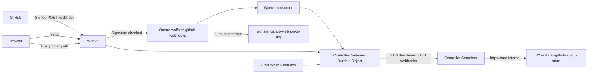

# Wolfstar GitHub Edge

The [Wolfstar GitHub Agent](../wolfstar-github-agent/README.md) on Cloudflare, with no machine of your own and no configuration file.

A Worker serves the public hostname. The controller runs unchanged inside one Cloudflare Container behind it, and a setup page creates the GitHub App.



## Deploy

```sh
pnpm --filter wolfstar-github-edge exec wrangler login
pnpm --filter wolfstar-github-edge deploy
```

The deploy needs Docker running locally, because Wrangler builds the Container image. The first run creates both Queues, the R2 bucket, and its lifecycle rule. Every later run ships an update.

Set `ALLOWED_OWNERS` in `wrangler.jsonc` first if the agent should act for an owner other than `wolfstar-project`. It takes owners, or `owner/repository` entries, separated by commas.

Then open the deployed URL at `/setup`:

1. **Create the GitHub App.** GitHub shows the manifest with every permission and the webhook already filled in. Only someone who can create Apps for the first owner in `ALLOWED_OWNERS` can finish this step, and an App created under any other owner is refused.
2. **Install the App** on the repositories the agent should work on.
3. **Add an Agent provider**: a Claude token from `claude setup-token`, the contents of `~/.codex/auth.json` after `codex login`, a GLM Coding Plan key for opencode, or a Cloudflare API token with Workers AI Read. One is enough. See [Workers AI](#workers-ai).
4. **Save the dashboard password** the page shows, then open the dashboard and sign in as `agent`.

To change providers later, open **Settings** in the dashboard, or `/setup/providers` and sign in with the dashboard password. Both save through the same checks, and saving restarts the controller. Settings never shows a saved secret back, only whether one is set. After you install the App on more repositories, GitHub returns you to `/setup/installed`, which restarts the controller so it clones them.

## Workers AI

Workers AI runs through opencode, so its models sit under opencode in the Agent selection, each named `cloudflare-workers-ai/@cf/...`. They bill your Cloudflare account per token and publish no quota window, so Reserve does not apply to them.

The setup page takes an API token with the Workers AI Read permission. Leave the account ID empty when the token sees one account, and the Worker finds it. Saving checks the token against Workers AI, so a wrong token fails there instead of on the first turn.

When Workers AI is the only provider, the Container pins `cloudflare-workers-ai/@cf/moonshotai/kimi-k2.7-code` the first time the controller starts, because every opencode role defaults to a GLM Coding Plan model. It leaves a selection you already chose alone. With other providers configured, pin a Workers AI model from the Agent selection yourself.

Each model exposes its own reasoning variants, and opencode refuses one a model lacks. The controller maps a role's effort to the closest variant the model has, and runs `kimi-k2.7-code` without one.

## Cloudflare Access

Put Access in front of the setup page and the dashboard, so nobody reaches them without signing in first. GitHub cannot sign in, so `/webhook` stays outside Access and keeps its signature check.

1. In Zero Trust, create a self-hosted application for the Worker hostname with an Allow policy for your email.
2. Create a second self-hosted application for the same hostname with the path `webhook` and a Bypass policy for Everyone. The more specific path wins.
3. Copy the first application's Application Audience (AUD) tag and your team domain into `wrangler.jsonc`:

```jsonc
"vars": {
  "ACCESS_TEAM_DOMAIN": "https://<team>.cloudflareaccess.com",
  "ACCESS_AUD": "<aud tag>",
}
```

With both set, the Worker checks the Access token on every request except `/webhook` and refuses one without a valid token, even if a policy is later edited by mistake. Set only one and every request fails, so a half configuration never leaves the dashboard open. The dashboard password still applies behind Access.

## What runs where

| Piece                | Where                            | Notes                                                                        |
| -------------------- | -------------------------------- | ---------------------------------------------------------------------------- |
| Webhook intake       | Worker                           | Checks the signature with the App's secret, answers 204, queues the delivery |
| Webhook relay        | Queue consumer                   | Retries from 10 seconds to 15 minutes, 20 times, then the dead letter queue  |
| Setup and secrets    | Durable Object storage           | The App key, webhook secret, dashboard password, and provider logins         |
| Controller           | Container, `standard-4`          | 4 vCPU, 12 GiB, 20 GB disk. Two Agents at once                               |
| Journal              | R2, `controller/state.sqlite`    | Restored at start, saved every 5 minutes and on shutdown                     |
| Codex login          | R2, `controller/codex-auth.json` | Codex rotates its refresh token, so the newest copy is kept                  |
| Large webhook bodies | R2, `deliveries/`                | Above 100 KB. Deleted once delivered, expired after 7 days                   |

The Container reaches R2 through `http://state.internal`, which the Worker answers with its own binding, so the Container holds no storage credential.

The controller keeps every check it has on Hogwild: the webhook signature, the dashboard password, Host and Origin. The Worker translates the public hostname to the one the controller expects, and refuses a state changing request whose Origin is not the public one.

## Limits

- **A restart loses up to 5 minutes of journal.** The journal is backed up every 5 minutes and on a clean shutdown. GitHub holds the durable workflow state, and Recovery rebuilds the rest.
- **Checkouts are cloned again after a restart.** The Container disk does not survive a restart, so each start clones every repository the App reaches. Large repositories make that start slower.
- **New repositories need a restart.** The controller matches repositories to checkouts when it starts. Installing the App through GitHub's page restarts it for you.
- **`gh` inside an Agent is not signed in.** Agents read GitHub through the controller. A provider task that shells out to `gh` for a private repository fails.
- **Updates ship with a deploy.** The dashboard update control reports that, instead of pulling a checkout.

## Develop

```sh
pnpm --filter wolfstar-github-edge test:run
pnpm --filter wolfstar-github-edge typecheck
```

The tests run the routes in Node against plain fakes for the Durable Object, the Queue, and R2. The Container runtime lives in the agent package, in `src/cloudflare-runtime.ts` and `src/cloudflare-container.ts`, with its own tests.
